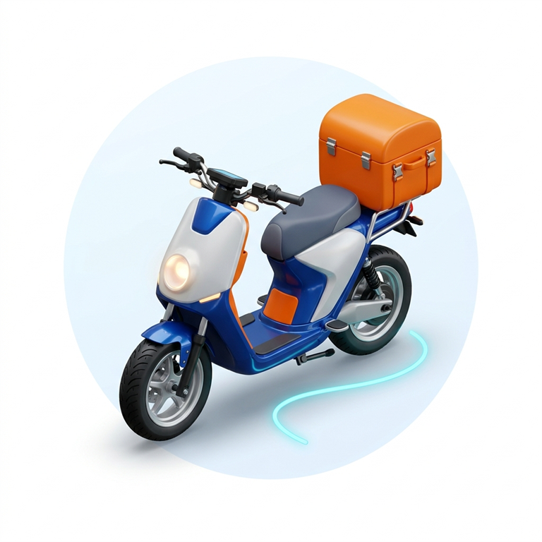
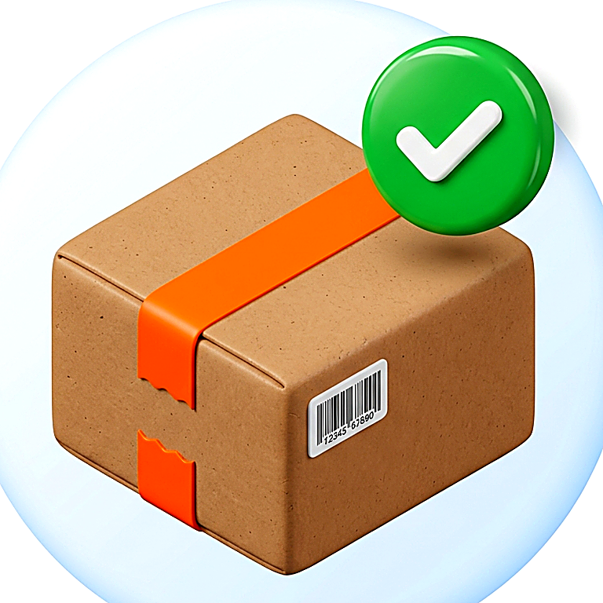
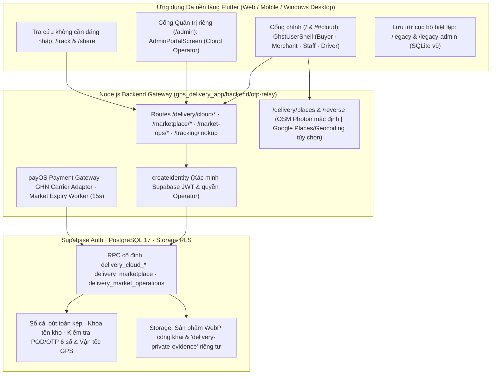
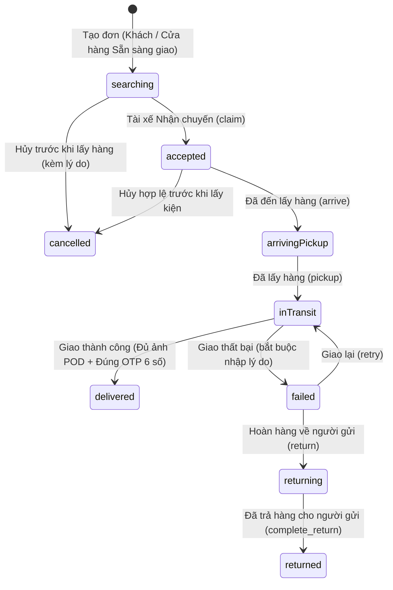

<div align="center">



# GO-MAU Delivery • Giao Hàng Siêu Tốc (GHST)

**Hệ Thống Ứng Dụng Giao Hàng Định Vị GPS Thời Gian Thực & Thương Mại Đa Cửa Hàng Đa Nền Tảng**

[](https://flutter.dev)
[](https://dart.dev)
[](gps_delivery_app/database/migrations/)
[](gps_delivery_app/lib/data/datasources/local/sqlite_offline_queue_datasource.dart)
[](gps_delivery_app/test/)

[**Tổng quan**](#-1-tổng-quan-dự-án) · [**Hệ sinh thái tính năng**](#-2-hệ-sinh-thái-tính-năng-nổi-bật) · [**4 Phân hệ nghiệp vụ**](#-3-kiến-trúc-4-phân-hệ-người-dùng) · [**Kiến trúc & Vòng đời đơn**](#-4-kiến-trúc-kỹ-thuật--vòng-đời-đơn-hàng) · [**Thuật toán cốt lõi**](#-5-các-thuật-toán-cốt-lõi-tại-tầng-edge--server) · [**Cài đặt & Khởi chạy**](#-7-hướng-dẫn-cài-đặt--khởi-chạy) · [**Kiểm thử**](#-8-kiểm-thử-tự-động--kiểm-chứng-thực-tế)

</div>

---

## 📌 1. Tổng Quan Dự Án

**GO-MAU Delivery (GHST Express)** là nền tảng giao nhận chặng cuối (*Last-mile Logistics*) kết hợp sàn thương mại & đặt món đa cửa hàng (*Multi-Shop Marketplace*), phát triển từ một cơ sở mã nguồn **Flutter & Dart** duy nhất cho **Web, Android, iOS và Windows Desktop**, đi kèm cổng **Node.js Backend Gateway** (`backend/otp-relay`) và cơ sở dữ liệu đám mây **Supabase Auth + PostgreSQL (`workflowVersion: 13`)**.

Hệ thống giải quyết 5 bài toán cốt lõi của giao vận và thương mại điện tử đô thị:
1. **Định danh thống nhất & phân quyền server (`Profile Schema 3`)**: Đăng nhập chính bằng **Supabase Auth** (Email/Mật khẩu & Google OAuth PKCE). Một khung giao diện **GHST EXPRESS** duy nhất phục vụ Khách hàng, Chủ shop, Nhân sự shop (`manager`/`staff`) và Tài xế theo quyền đã được server phê duyệt; cổng **Cloud Operator (`/admin`)** tách biệt hoàn toàn.
2. **Đặt đơn trực tiếp trên bản đồ & định giá phía server**: Người dùng chạm trực tiếp trên bản đồ tương tác hoặc nhập tìm kiếm địa chỉ để ghim điểm lấy `[A]`, điểm giao `[B]` và các điểm dừng trung gian (`#1..#5`) mà không cần nhập tọa độ thủ công; toàn bộ phí vận chuyển, phụ phí, voucher, Flash Sale và xu đều do PostgreSQL tính toán và khóa phiên bản.
3. **Chống nhiễu & gian lận tín hiệu GPS**: Kết hợp bộ lọc **Kalman 2D**, bộ kiểm định **3 lớp chống Fake GPS** trên thiết bị và chặn bước nhảy vận tốc `<= 120 km/h` phía server PostgreSQL.
4. **An toàn bàn giao, đối soát bút toán kép & hậu mãi**: Cổng bắt buộc tải ảnh bằng chứng (**POD**) và/hoặc xác thực **mã OTP 6 chữ số của người nhận** khi giao hàng; sổ cái kế toán kép bất biến (`delivery_market_journals` / `delivery_market_ledger`) tách biệt hoàn toàn trạng thái giao hàng với quyết toán COD/trả trước `payOS`, hoàn tiền theo dòng sản phẩm và chi trả shop sau 7 ngày.
5. **Khởi tạo sạch & cô lập dữ liệu lưu trữ (`/legacy`)**: Không nạp tài khoản ảo, số dư giả hay đơn mẫu; hàng đợi offline SQLite `v9` gắn chặt phạm vi `project + Auth ID + local ID`, giữ các màn hình SQLite cũ độc lập tại `/legacy` và `/legacy-admin` mà không tự động trộn dữ liệu local vào danh tính Cloud.

### Thông tin Học thuật & Nhóm phát triển

| Hạng mục | Nội dung chi tiết |
| :--- | :--- |
| **Đơn vị đào tạo** | Viện Công Nghệ Số – Trường Đại học Thủ Dầu Một (TDMU) |
| **Học phần** | Phát triển ứng dụng đa nền tảng |
| **Đề tài** | Xây dựng hệ thống ứng dụng giao hàng định vị GPS thời gian thực đa nền tảng |
| **Giảng viên hướng dẫn** | **Võ Văn Lên** |
| **Nhóm thực hiện (Nhóm 14)** | **Phạm Trí Hiển** · **Nguyễn Phương Nam** · **Nguyễn Minh Nhân** |
| **Quy mô hệ thống** | **4 phân hệ Cloud + lưu trữ `/legacy`** · **12 bản di trú SQL (`workflowVersion: 13`)** · **35+ bảng RLS Cloud & 18 bảng cục bộ** |

---

## 🚀 2. Hệ Sinh Thái Tính Năng Nổi Bật

| Nhóm tính năng | Mô tả kỹ thuật & Nghiệp vụ thực tế |
| :--- | :--- |
| 🗺️ **Chọn & Tìm Địa Chỉ Trực Tiếp Trên Bản Đồ**<br>*(Interactive Map Picker + Reverse Geocode)* | Trên form **Tạo đơn hàng (`CloudOrderForm`)**, người dùng ghim điểm lấy `[A]`, điểm giao `[B]` và tối đa 5 điểm dừng trung gian trực tiếp bằng thao tác chạm trên bản đồ (`/delivery/reverse`), nút `Vị trí hiện tại (GPS)`, hoặc tìm kiếm địa chỉ trực tiếp (`/delivery/places`) kèm xem trước lộ trình thực tế — loại bỏ hoàn toàn việc nhập tay Vĩ độ / Kinh độ. |
| ⚡ **5 Chế Độ Giao Hàng Cloud & Đa Điểm Dừng** | Hỗ trợ đầy đủ trên PostgreSQL: **Tiêu chuẩn (`standard`)**, **Giao nhanh (`express`)**, **Tiết kiệm 4h (`saving`)**, **Ghép đơn 2H (`same_day_2h`)** và **Xe tải nhẹ (`truck`)**; tính trọng lượng quy đổi `D×R×C / 5000`, đa điểm dừng (`+5.000đ/điểm`), khứ hồi (`+60%`), bảo hiểm khai giá (`0,5%`, kẹp `2.000đ..150.000đ`), ưu tiên xe điện EV (`48g CO₂/km`) và Quỹ Xanh (`+1.000đ`). |
| 🛍️ **Sàn Đặt Món & Mua Sắm Đa Cửa Hàng (`delivery_market_*`)** | Gian hàng có ảnh bìa, bán kính phục vụ (`service_radius_km`), lịch mở cửa theo múi giờ `Asia/Ho_Chi_Minh`, phân quyền nhân sự (`manager` / `staff`), biến thể đa SKU, nhóm tùy chọn/topping, giỏ hàng khóa phiên bản và đặt mua nguyên tử nhiều cửa hàng cùng lúc (COD hoặc trả trước `payOS`). |
| 🎟️ **Voucher Ngân Sách, Flash Sale & Ví Xu Server** | Quản lý ngân sách Voucher nền tảng/cửa hàng (`delivery_market_vouchers`), khung giờ & hạn mức Flash Sale nguyên tử (`delivery_market_flash_sales`), và sổ cái Xu phía server (`delivery_market_coin_ledger`: đổi tối đa `20%`, tích `1%` sau quyết toán, tự động thu hồi khi hủy/hoàn). |
| 🔒 **Xác Thực POD / OTP 6 Số, Tệp Riêng Tư & Tra Cứu `/track`** | Lưu mật khẩu OTP 6 số người nhận trong bảng bảo mật riêng (`delivery_cloud_order_secrets`), đính kèm chứng từ riêng tư (`chat`, `return`, `finance`) vào kho RLS `'delivery-private-evidence'`, tạo link chia sẻ thu hồi được (`SHA-256` token 256-bit tại `/share` & `delivery_cloud_shares`) và tra cứu vận đơn công khai tại `/track` không lộ địa chỉ/SĐT/tiền. |

---

## 🧩 3. Kiến Trúc 4 Phân Hệ Người Dùng

<table>
  <tr>
    <td width="50%" valign="top">
      
      <h4>1. Khách hàng / Người mua (Buyer & Sender)</h4>
      <ul>
        <li>Đăng ký / Đăng nhập <b>Supabase Auth</b> (Email/Mật khẩu & Google OAuth PKCE trên Web/Windows Desktop).</li>
        <li>Sổ địa chỉ Cloud (tối đa 25 địa chỉ, khóa phiên bản) & công cụ nhập có xác nhận từ địa chỉ local.</li>
        <li>Tạo đơn giao hàng chọn trực tiếp & tìm kiếm trên bản đồ, hẹn giờ lấy, khai giá, chọn EV, POD & OTP 6 số.</li>
        <li>Đặt hàng đa shop, áp dụng Voucher / Flash Sale / Xu server, chat đính kèm ảnh, đổi trả theo dòng SKU và đánh giá sản phẩm / shop / tài xế.</li>
      </ul>
    </td>
    <td width="50%" valign="top">
      
      <h4>2. Đối tác Tài xế (Approved Driver)</h4>
      <ul>
        <li>Gửi yêu cầu đăng ký đối tác tài xế độc lập ngay trong hồ sơ Cloud, kích hoạt khi Operator phê duyệt.</li>
        <li>Xem hàng đợi <b>Chờ nhận</b> đã ẩn thông tin nhạy cảm trước khi nhận chuyến; khóa nhận chuyến nguyên tử chống trùng.</li>
        <li>Thực hiện chu trình <code>Đã đến lấy hàng -> Đã lấy hàng -> Giao thành công</code> kèm tải ảnh POD và nhập mã OTP 6 số từ người nhận.</li>
        <li>Xử lý giao thất bại có lý do, giao lại, hoàn hàng về người gửi và đề xuất thu tiền COD có chứng từ.</li>
      </ul>
    </td>
  </tr>
  <tr>
    <td width="50%" valign="top">
      
      <h4>3. Đối tác Cửa hàng & Nhân sự Shop (Merchant & Staff)</h4>
      <ul>
        <li>Quản lý gian hàng, ảnh bìa, bán kính phục vụ, lịch mở cửa và ủy quyền nhân sự (<code>manager</code> / <code>staff</code>).</li>
        <li>Biên tập sản phẩm đa biến thể SKU, kích thước kiện hàng, nhóm topping, ảnh WebP đã xóa metadata và sổ kiểm toán tồn kho.</li>
        <li>Xác nhận đơn mua trong hạn 15 phút, bấm <b>Sẵn sàng giao</b> sinh vận đơn nội bộ hoặc <b>tách nhiều kiện hàng</b> (<code>order_shipment_split</code>).</li>
        <li>Xử lý yêu cầu trả hàng, kiểm định kho (<code>restock</code> / <code>writeoff</code>), phản hồi đánh giá và theo dõi đối soát.</li>
      </ul>
    </td>
    <td width="50%" valign="top">
      
      <h4>4. Cổng Quản trị Cloud Operator (<code>/admin</code>)</h4>
      <ul>
        <li>Tách biệt hoàn toàn tại <code>/admin</code> (hoặc <code>/#/admin</code>), yêu cầu phiên Supabase có quyền <code>operator</code> từ server.</li>
        <li>Bảng phân tích <code>admin_analytics</code> thời gian thực (tách bạch GMV ước tính và doanh thu đã quyết toán).</li>
        <li>Phê duyệt / thu hồi tư cách Merchant & Driver, duyệt gian hàng, kiểm duyệt báo cáo đánh giá vi phạm.</li>
        <li>Đối soát tài chính phê duyệt chéo 2 người (COD, hoàn tiền, quyết toán shop), quản lý Voucher / Flash Sale, chạy tiến trình <code>market_jobs</code> và cấu hình khóa API phía backend.</li>
      </ul>
    </td>
  </tr>
</table>

---

## 🏗️ 4. Kiến Trúc Kỹ Thuật & Vòng Đời Đơn Hàng

### 4.1. Kiến trúc Cloud-Authoritative & Lưu trữ phân tách



### 4.2. Chu trình Trạng thái Vận đơn Cloud (`delivery_cloud_orders`)



---

## 🧠 5. Các Thuật Toán Cốt Lõi Tại Tầng Edge & Server

1. **Định giá, Khóa phiên bản & Bút toán kép trên PostgreSQL** ([`20261107_cloud_commercial_suite.sql`](gps_delivery_app/database/migrations/20261107_cloud_commercial_suite.sql))
   - Mọi báo giá vận chuyển và giỏ hàng đều gắn phiên bản dữ liệu (`pricing_version`, `cart_version`, `address_version`, `terms_version`) và thời hạn hiệu lực; sổ cái `delivery_market_ledger` kiểm tra cân bằng Nợ/Có cho từng giao dịch COD, trả trước `payOS`, tài trợ khuyến mãi (`promo_expense`), hoàn tiền và chi trả cửa hàng.
2. **Lọc nhiễu tín hiệu vệ tinh Kalman 2D** ([`kalman_gps_filter.dart`](gps_delivery_app/lib/core/gps/kalman_gps_filter.dart))
   - Triệt tiêu hiện tượng nhảy tọa độ do phản xạ đa đường dựa trên phương sai dự đoán $P_{k|k-1} = P_{k-1} + \Delta t \cdot q^2$ ($q = 3.0\text{ m/s}$) và hệ số lợi ích Kalman $K_k$.
3. **Kiểm định chống gian lận vị trí 3 lớp & Chặn nhảy GPS phía Server** ([`gps_integrity_validator.dart`](gps_delivery_app/lib/core/gps/gps_integrity_validator.dart))
   - Kiểm tra cờ giả lập hệ điều hành, đối chiếu gia tốc kế IMU trên thiết bị và xác thực khoảng cách/vận tốc `<= 120 km/h` (`<= 30m` khi $\Delta t \le 0$) ngay trong PostgreSQL.
4. **Điều phối đa trọng số, 2-Opt TSP & Đề xuất VROOM** ([`smart_dispatch_engine.dart`](gps_delivery_app/lib/core/gps/smart_dispatch_engine.dart))
   - Tối ưu thứ tự trạm giao đa điểm bằng **Nearest-Neighbor + 2-Opt** và hỗ trợ bộ giải phân tuyến đội xe `VROOM` qua OSRM ma trận đường bộ.
5. **Chuẩn mã hóa thanh toán EMVCo VietQR & Vận đơn Code-128B** ([`security_and_barcode_utils.dart`](gps_delivery_app/lib/core/utils/security_and_barcode_utils.dart))
   - Sinh chuỗi TLV chuẩn Napas247 kèm mã kiểm tra dư vòng **CRC-16/CCITT-FALSE** (`0x1021`) và vẽ mã vạch tuyến tính chuẩn `Code-128B` trên tem nhiệt A6.

---

## 📂 6. Cấu Trúc Thư Mục Trọng Tâm

```text
DoAn_PhatTrienUngDungDiDongDaNenTang/
├── PROJECT_CONTEXT.md                        # Kiến trúc chuẩn, phạm vi phiên bản & vận hành local
├── WORKLOG.md                                # Nhật ký bàn giao kỹ thuật & bằng chứng kiểm thử
├── README.md                                 # Tài liệu tổng quan dự án
├── Bao_Cao_Tieu_Luan_Nhom14.docx             # Báo cáo thuyết minh học phần (Nhóm 14 - TDMU)
└── gps_delivery_app/                         # Ứng dụng Flutter & Backend Gateway
    ├── COMMERCIALIZATION_PLAN.md             # Lộ trình thương mại hóa P0–P7
    ├── EXECUTION_CHECKLIST.md                # Tiến độ thực thi & các cổng nghiệm thu triển khai
    ├── P0_SYNC_MATRIX.md                     # Ma trận đồng bộ dữ liệu & phân tách Cloud / Legacy
    ├── backend/otp-relay/                    # Node.js Backend Gateway (Express, PostgreSQL TLS, OCR, Jobs)
    │   ├── server.mjs                        # Điểm khởi chạy API (:8787) & tiến trình nền market_jobs
    │   ├── CLOUD_ORDERS.md                   # Đặc tả API & quy trình vận đơn Cloud
    │   ├── MARKETPLACE.md                    # Đặc tả Marketplace, đối soát kế toán & bộ thương mại v13
    │   ├── COMMERCE.md                       # Đặc tả tích hợp payOS, GHN & kiểm tra sẵn sàng
    │   └── INTEGRATIONS.md                   # Quản lý tích hợp tập trung (Photon/Google Maps, OSRM, SMTP, FCM)
    ├── database/migrations/                  # 12 bản di trú SQL bổ sung (20261027 -> 20261107, workflow 13)
    ├── lib/
    │   ├── main.dart                         # Định tuyến chung phiên Cloud (/, /cloud, /admin, /track, /share, /legacy)
    │   ├── core/                             # Supabase Auth/OAuth PKCE, CloudAccountSession, GPS, GeoMath
    │   ├── data/                             # CloudOrdersRepository & SQLite Offline Queue v9
    │   └── presentation/                     # GhstUserShell, CloudOrderForm (Map Picker), Marketplace, AdminPortal
    ├── test/                                 # 277 kịch bản kiểm thử đơn vị & Widget đa khung hình
    └── tool/                                 # Script kiểm chứng PostgreSQL 17 & trình duyệt Playwright/Edge
```

---

## ⚡ 7. Hướng Dẫn Cài Đặt & Khởi Chạy

### 7.1. Khởi chạy Backend Gateway (`http://127.0.0.1:8787`)

```powershell
cd gps_delivery_app/backend/otp-relay
npm ci
Copy-Item .env.example .env
# Cấu hình SUPABASE_URL, SUPABASE_ANON_KEY và DATABASE_URL trong .env (hoặc qua trang /#/admin)
npm run migrate:cloud
npm start
```

Kiểm tra trạng thái dịch vụ: `Invoke-RestMethod http://127.0.0.1:8787/health`

### 7.2. Khởi chạy Ứng dụng Flutter (Web & Windows Desktop)

```powershell
cd gps_delivery_app
flutter pub get

# Biên dịch bản Web kết nối tới Backend Gateway local
flutter build web --no-wasm-dry-run --no-web-resources-cdn `
  --dart-define=DELIVERY_API_BASE_URL=http://127.0.0.1:8787/delivery/

# Hoặc biên dịch bản Windows Desktop Release
flutter build windows --release `
  --dart-define=DELIVERY_API_BASE_URL=http://127.0.0.1:8787/delivery/
```

Các đường dẫn truy cập trên trình duyệt (`http://127.0.0.1:8080/`):
- 📱 **Ứng dụng chính (Khách hàng / Cửa hàng / Tài xế)**: `http://127.0.0.1:8080/` (hoặc `/#/cloud` mở thẳng mục đơn giao hàng)
- 🛡️ **Cổng Quản trị Cloud Operator**: `http://127.0.0.1:8080/#/admin`
- 🔍 **Tra cứu vận đơn công khai**: `http://127.0.0.1:8080/#/track`
- 🗄️ **Lưu trữ cục bộ SQLite cũ (tách biệt)**: `http://127.0.0.1:8080/#/legacy` và `/#/legacy-admin`

---

## 🧪 8. Kiểm Thử Tự Động & Kiểm Chứng Thực Tế

Dự án duy trì kiểm chứng nhiều lớp từ PostgreSQL gốc, Node.js Gateway, Flutter Analyzer/Test đến trình duyệt thực tế:

```powershell
# 1. Kiểm thử Backend (111/111 bài kiểm thử SQL/Gateway/Security) & PostgreSQL 17 độc lập (22/22 nhóm)
cd gps_delivery_app/backend/otp-relay
npm test
npm run test:postgres

# 2. Phân tích tĩnh (0 lỗi) & 277 kịch bản kiểm thử Flutter
cd ../..
flutter analyze --no-pub
flutter test --no-pub

# 3. Kiểm thử trình duyệt hồi quy đa khung hình (360px & 1440px)
node tool/check-cloud-browser.cjs
node tool/check-marketplace-browser.cjs
node tool/check-admin-browser.cjs
node tool/check-full-ui-acceptance.cjs
```

- **Kiểm thử cô lập & Hồi quy giao diện**: `22/22` nhóm PostgreSQL 17 gốc, `111/111` bài test Node backend, `0` lỗi phân tích tĩnh, `277` bài test Flutter và `62` ảnh chụp nghiệm thu giao diện đa vai trò (`build/verification/acceptance/`).
- **Kiểm thử thực chiến Zero-Mock trên Cloud thật (`2026-11-01`)**: Đã xác minh luồng đa vai trò trực tiếp trên Microsoft Edge + Backend `:8787` + Supabase Auth/PostgreSQL thật (`buyer`, `merchant`, `driver`, `operator`, `/#/track`, chọn & tìm địa chỉ trực tiếp trên bản đồ không nhập tọa độ tay, xác thực OTP 6 số khi giao và khôi phục nguyên trạng CSDL sau kiểm thử tại `build/verification/live-e2e/live-e2e-report.json`).
- **Giới hạn trước mở bán thương mại**: Các nhà cung cấp bên thứ ba (`payOS`, `GHN`, FCM) và tên miền `PUBLIC_BASE_URL` HTTPS công khai cần được cấp khóa thật và nghiệm thu trên thiết bị vật lý độc lập theo [`EXECUTION_CHECKLIST.md`](gps_delivery_app/EXECUTION_CHECKLIST.md).

---

<div align="center">

Phát triển bởi **Nhóm 14 – Viện Công Nghệ Số, Trường Đại học Thủ Dầu Một**  
*Phạm Trí Hiển · Nguyễn Phương Nam · Nguyễn Minh Nhân*

</div>
